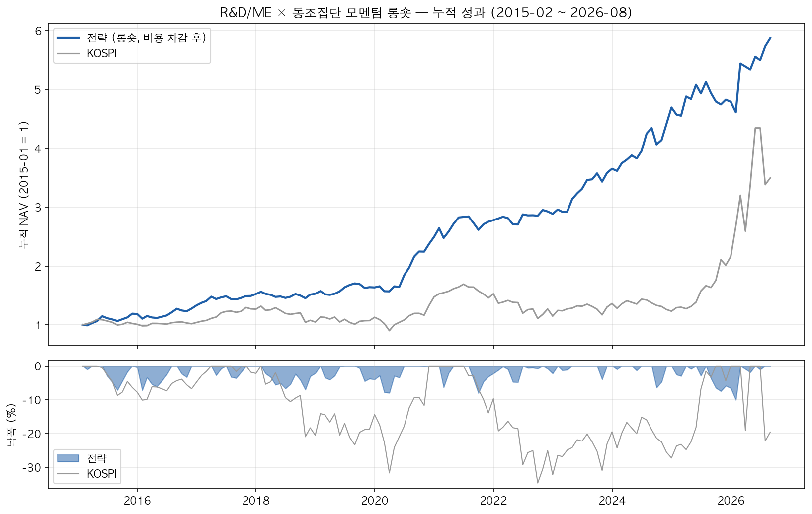
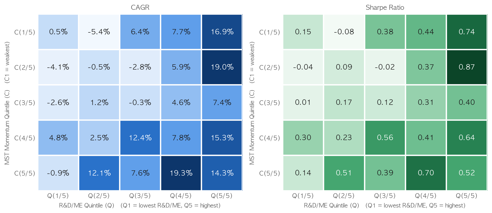
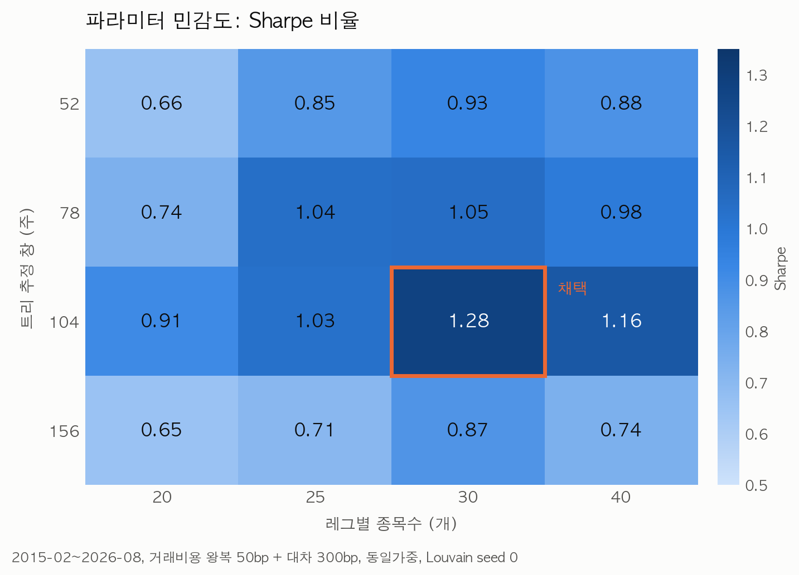

# R&D/시가총액 × 동조집단 모멘텀 롱숏 전략

기업이 미래를 위해 쓰는 돈(**연구개발비**)에 비해 시장 가치가 싼 기업을 사고, 비싼 기업을 파는 국내 대형주 롱숏 전략입니다.
"싸다/비싸다"는 시장 전체와 비교하지 않고, **주가 상관구조에서 직접 추출한 동료 집단(MST + Louvain)** 안에서 비교합니다.

> QUANTIFI(서강대학교 퀀트 학회) 프로젝트 · 백테스트 2015-02 ~ 2026-08 (139개월)



## 성과 요약 (거래비용 왕복 50bp + 대차비용 연 300bp 차감 후)

| 지표 | 전략 | KOSPI |
|---|---|---|
| CAGR | **16.52%** | 11.42% |
| 연율 변동성 | **12.65%** | 24.62% |
| Sharpe | **1.28** | 0.56 |
| MDD (월말 기준) | **−10.0%** | −34.6% |
| 월 승률 | 60.4% | 56.8% |
| 손실 연도 | **0개** | 3개 |
| Carhart 4팩터 α (연) | **+12.78%** (t = 4.02) | – |
| KOSPI 베타 | 0.10 | 1 |

- 롱 레그는 연 +19.3%, 숏 레그(숏으로 판 바스켓)는 연 −4.4%이고, 월 회전율은 55.8%입니다.
- 구간별 Sharpe는 IS(2015-02~2020-06) 1.07, OOS(2020-07~2026-08) 1.44입니다.
- 팩터 로딩은 SMB +0.014(p = 0.86)로, 소형주 효과로 설명되지 않습니다. R²는 0.134입니다.

| 2015 | 2016 | 2017 | 2018 | 2019 | 2020 | 2021 | 2022 | 2023 | 2024 | 2025 | 2026 (1~8월) |
|---|---|---|---|---|---|---|---|---|---|---|---|
| +18.3 | +12.6 | +14.4 | +0.2 | +7.0 | +52.5 | +11.4 | +3.9 | +26.6 | +28.5 | +2.1 | +22.7 |

## 아이디어

1. **R&D는 비용으로 처리되지만 실제로는 투자입니다.** 그래서 R&D 집약 기업의 가치는 장부에 덜 반영되고, R&D/시가총액(rd_me)이 높은 기업은 이후 초과수익을 냅니다 (Chan, Lakonishok & Sougiannis 2001).
2. **산업분류표는 실제 동조 관계를 다 잡지 못합니다.** 그래서 비교 대상(동료 집단)을 주가 데이터에서 직접 찾습니다.

## 방법론

| 단계 | 내용 | 근거 |
|---|---|---|
| 유니버스 | R&D 공시기업 중 시가총액 상위 30% (분기 갱신), 60일 거래대금 하위 10% 제외, 지주사 제외 → 월평균 274종목 | |
| 팩터 | rd_me = 연간 연구개발비 / 월말 시가총액. DART 공시 **접수일 + 1개월 말**부터 사용 (PIT) | Chan et al. (2001) |
| 동조집단 | 직전 104주 **주간** 수익률 → 시장베타 잔차 → 거리 d = √(2(1−ρ)) → **MST** → **Louvain** (평균 16.6개 군집) | Epps (1979), Mantegna (1999), Blondel et al. (2008), Onnela et al. (2002) |
| 모멘텀 | t−13 ~ t−2 수익률 (11개월, 직전 2개월 제외) | Jegadeesh (1990), Novy-Marx (2012) |
| 신호 | (2 × rank(자기 모멘텀) + 1 × rank(군집 평균 모멘텀)) / 3 | |
| **롱 30** | R&D **금액**이 소속 군집 평균보다 큰 기업 → 그중 rd_me 상위 30 | |
| **숏 30** | 신호 하위 50% ∩ R&D 금액이 군집 평균보다 작은 기업 → 그중 rd_me 하위 30 | |
| 운용 | 동일가중, 월간 리밸런싱, 그로스 200% / 넷 0% | |

R&D **금액** 게이트를 먼저 거는 이유는, rd_me만으로 고르면 단순히 시가총액이 작아진 기업이 상위로 올라오기 때문입니다. 게이트를 넣으면 Sharpe가 1.08에서 1.28로 오릅니다.



rd_me 5분위(롱온리) CAGR은 Q1 −0.5% → Q2 3.9% → Q3 5.1% → Q4 9.9% → Q5 15.5%로 **완전 단조**입니다.

## 과적합 점검

표본내에서 적합(fit)한 파라미터는 없습니다. 상관·베타·군집·모멘텀은 모두 각 시점의 직전 데이터로만 계산합니다. 다만 선택값 15개를 바꿔 가며 약 61개 설정을 시험했기 때문에, 그 결과를 모두 공개합니다.

- **Deflated Sharpe Ratio** (Bailey & López de Prado 2014): 61회 탐색을 가정하면 99.8%, 1,000회를 가정해도 98.9%입니다.
- **문헌 기본형**만으로도 Sharpe 1.08이 나옵니다 (Onnela 4년 창 + 12-1 모멘텀 + 게이트 없음).
- **민감도 격자**: 어느 축을 흔들어도 Sharpe 0.86 ~ 1.39로 양(+)을 유지합니다. 다만 트리 창(104주)과 종목 수(30)는 이웃값보다 눈에 띄게 높습니다.



전체 격자, 설계 기여도 분해, 예상 질문과 답변은 [docs/전략_설명.md](docs/전략_설명.md)에 있습니다.

## 한계 (함께 밝혀야 할 것)

- **사후 선택**: 모멘텀 창의 "2개월 제외"는 결과를 본 뒤 선택했습니다. 근거와 전체 격자는 [research/기록_모멘텀창_변경.txt](research/기록_모멘텀창_변경.txt)에 있습니다.
- **Louvain seed 의존성**: seed 0/1/2에서 Sharpe가 각각 1.28 / 1.16 / 1.09입니다. 헤드라인 수치는 seed 0입니다.
- **2020년 집중**: 2020년 +52.5%가 모든 10년 구간에 포함됩니다. 2020년을 빼면 CAGR이 3~4%p 낮아집니다.
- **대형주 전용**: 같은 사양을 시가총액 30~60% 구간에 적용하면 Sharpe 0.13, 50~80% 구간은 −0.10입니다.
- **MDD는 월말 기준**이라 월중 낙폭은 반영되지 않습니다.
- **상장폐지 손실 미반영**: 종목이 사라지면 그 달 수익률이 결측이 되어 포지션이 빠집니다. 편입 종목 403개 중 24개가 해당합니다.
- **공매도 금지기간**(2020-03~2021-04, 2023-11~2025-03)에도 숏을 유지한다고 가정했습니다. 이 구간을 롱온리로 바꾸면 Sharpe는 1.22입니다.
- **비용 가정**: 거래비용과 대차비용을 전 종목에 동일하게 적용했습니다. 월별 수익률은 횡단면 1% 윈저라이즈했습니다.
- **종목명 기준 결합**: 데이터를 종목코드가 아닌 종목명으로 결합합니다. 사명 변경 시 시계열이 끊길 수 있습니다.

## 구현 시 주의: 숏 선택 버그

개발 중에 `pool.nsmallest(2n).index.difference(L)[:n]` 패턴에서 버그를 발견해 고쳤습니다. pandas `Index.difference()`가 결과를 **가나다순으로 정렬**하기 때문에, 숏 바스켓이 "rd_me 하위 30종목"이 아니라 "하위 60종목 중 이름순 앞 30개"가 되고 있었습니다.
수정한 코드는 `pool.drop(index=L, errors="ignore").nsmallest(n).index`입니다. 버그 전후 비교는 [research/fixsel.py](research/fixsel.py)에 있습니다.

## 폴더 구조

```
├── rd_me_MST_전략.py        # 단일 파일 재현 코드 (데이터 적재 → 팩터 → 트리 → 백테스트)
├── docs/
│   ├── 전략_설명.md           # 전체 전략 문서 (방법론·성과·로버스트니스·예상질문·참고문헌)
│   └── 최종전략_요약.md
├── research/                # 분석·검증 스크립트, 사전등록 문서, 의사결정 기록
├── results/                 # 월별 백테스트, NAV, 5분위 NAV, 히트맵, 결과 엑셀
└── data/                    # 원본 데이터 위치 (저장소에는 미포함)
```

## 실행 방법

```bash
pip install -r requirements.txt
# data/README.md에 적힌 파일을 data/에 넣은 뒤
python3 rd_me_MST_전략.py          # 약 30초 → 콘솔 성과 요약 + results/rd_me_MST_백테스트_월별.csv
```

분석 스크립트는 `research/` 폴더 안에서 실행합니다 (예: `cd research && python3 FINAL.py`). 스크립트끼리 `exec`로 이어지기 때문입니다.
